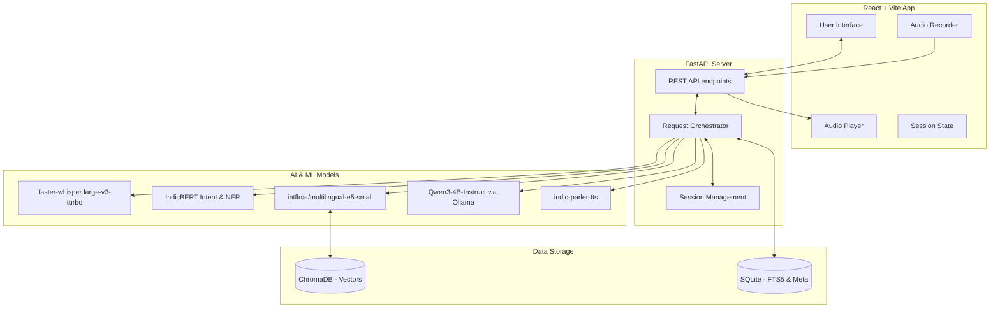

# System Architecture

## 1. High-Level Architecture Diagram



## 2. Technical Decisions (LOCKED)

### 2.1 ASR (Speech-to-Text)
*   **Decision:** `faster-whisper` with `large-v3-turbo` (INT8 quantized).
*   **Reason:** Excellent accuracy for Tamil and Tanglish; quantization allows it to run within 8GB RAM constraints.
*   **Alternatives:** OpenAI Whisper API (rejected: costs money), Google Speech-to-Text (rejected: costs money).
*   **Cost:** ₹0.
*   **Hardware:** Runs on CPU (8GB RAM).
*   **License:** MIT.
*   **Risks:** High CPU usage during transcription.
*   **Fallback:** `whisper-small` GGUF format if RAM is heavily constrained.

### 2.2 LLM (Language Model)
*   **Decision:** `Qwen3-4B-Instruct` via Ollama (4-bit GGUF).
*   **Reason:** Exceptional multilingual capabilities (including Tamil) in a small parameter size. Ollama provides a robust local inference server.
*   **Alternatives:** Llama-3.1-8B (rejected for 8GB RAM limit, but is the *Best* option if 16GB is available). Sarvam-2B (Alternative fallback).
*   **Cost:** ₹0.
*   **Hardware:** CPU inference via Ollama; fits within 8GB RAM (4-bit quantization).
*   **License:** Apache 2.0 / Open weights.
*   **Risks:** Hallucinations in edge cases.
*   **Fallback:** Sarvam-2B or Gemma-4-E2B.

### 2.3 Embedding Model
*   **Decision:** `intfloat/multilingual-e5-small`.
*   **Reason:** Native multilingual support, very small memory footprint, fast CPU inference.
*   **Alternatives:** BAAI/bge-m3 (rejected for 8GB baseline as it is too large, but used if 8GB+ is available).
*   **Cost:** ₹0.
*   **Hardware:** Minimal CPU footprint.
*   **License:** MIT.
*   **Risks:** Lower recall for highly complex hybrid-language queries compared to massive models.
*   **Fallback:** FastText.

### 2.4 Vector Database
*   **Decision:** ChromaDB.
*   **Reason:** Local, persistent, serverless vector database that integrates easily with Python.
*   **Alternatives:** Qdrant (overkill for MVP), FAISS (lacks easy metadata filtering).
*   **Cost:** ₹0.
*   **Hardware:** Minimal footprint, file-system based.
*   **License:** Apache 2.0.

### 2.5 TTS (Text-to-Speech)
*   **Decision:** `ai4bharat/indic-parler-tts`.
*   **Reason:** High-quality, natural-sounding Tamil speech generation.
*   **Alternatives:** `facebook/mms-tts-tam` (Fallback), `espeak-ng` (Ultra-low fallback).
*   **Cost:** ₹0.
*   **Hardware:** CPU inference.
*   **License:** CC-BY-NC 4.0 / Open.

### 2.6 Application Stack
*   **Frontend:** React + Vite + Tailwind CSS + shadcn/ui.
*   **Backend:** Python FastAPI.
*   **Database:** SQLite with FTS5 (for scheme metadata and session storage).
*   **OCR (Data Ingestion):** Surya OCR (primary) / EasyOCR (fallback) / pdfminer.six.
*   **Language Detection:** `lingua-py` + Unicode script detection.

## 3. Pipeline Architectures

### 3.1 Voice Pipeline
1.  **Ingestion:** Browser records `MediaRecorder` audio blobs.
2.  **Transport:** Frontend posts `.wav` to FastAPI `/api/transcribe`.
3.  **ASR:** `faster-whisper` converts audio to text.
4.  **Processing:** Text is sent to the Text Pipeline.
5.  **Synthesis:** LLM text output is passed to `indic-parler-tts`.
6.  **Delivery:** Audio `.wav` streamed back to the client.

### 3.2 Text & RAG Pipeline
1.  **Input:** User text arrives at `/api/chat`.
2.  **Language/Intent Check:** Detect script and intent (IndicBERT).
3.  **Retrieval:** Embed user query using `multilingual-e5-small`, query ChromaDB for top-K chunks.
4.  **Hybrid Search:** Concurrently run FTS5 query on SQLite for exact keyword matches.
5.  **Context Construction:** Combine Top-K vector results + FTS5 results.
6.  **Generation:** Prompt Ollama (`Qwen3-4B-Instruct`) with System Prompt + Context + Conversation History + Query.
7.  **Parsing:** Extract LLM response, UI rendering metadata, and TTS text.

### 3.3 Eligibility Engine Architecture
Instead of rigid code-based rules, eligibility relies on LLM reasoning over structured RAG data.
*   **Profile State:** Maintained in memory (or SQLite Session table). Contains keys like `age`, `gender`, `caste`, `income`.
*   **Evaluation:** LLM is given the user profile JSON and the scheme requirements text. Prompt instructs the LLM to output missing fields or a True/False eligibility status.

## 4. File and Directory Organization
```text
tamilnadu-scheme-assistant/
├── backend/
│   ├── app/
│   │   ├── api/          # FastAPI routes
│   │   ├── core/         # Config, security
│   │   ├── services/     # RAG, LLM, ASR, TTS service wrappers
│   │   ├── db/           # SQLite and ChromaDB init
│   │   └── models/       # Pydantic schemas
│   ├── data/
│   │   ├── raw/          # Raw government PDFs
│   │   └── processed/    # Parsed JSON/Markdown scheme data
│   ├── scripts/          # Ingestion and OCR scripts
│   └── requirements.txt
├── frontend/
│   ├── src/
│   │   ├── components/   # UI Components (shadcn)
│   │   ├── hooks/        # Audio and API hooks
│   │   └── lib/          # Utils
│   ├── package.json
│   └── vite.config.ts
├── docs/                 # Documentation (You are here)
└── docker-compose.yml    # Local deployment configuration
```
