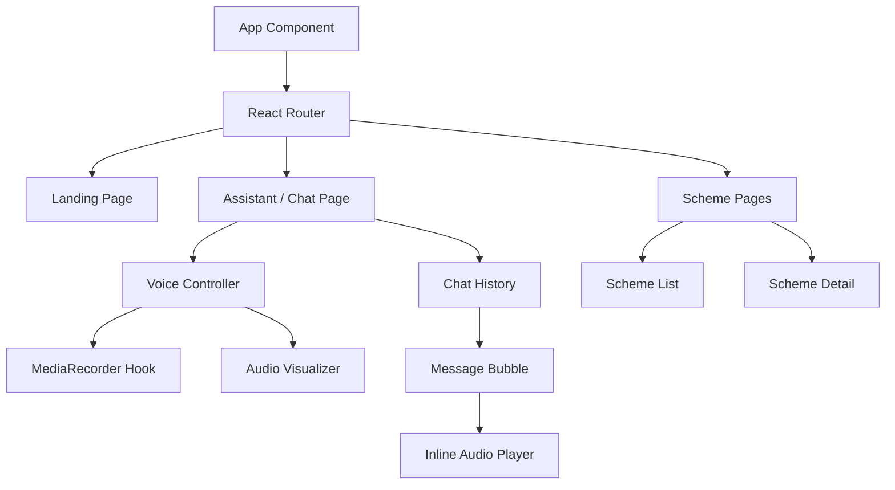

# Frontend Architecture: Tamil Nadu Scheme Assistant

## 1. Decision: Tech Stack
* **Framework:** React + Vite + TypeScript
* **Styling:** Tailwind CSS v4 + shadcn/ui component library
* **State Management:** Zustand (lightweight, avoids boilerplate)
* **API Client:** Axios / native `fetch` (with custom hooks)
* **Reasoning:** Vite provides fast HMR. shadcn/ui offers accessible, customizable components without heavy runtime overhead. Zustand is simpler than Redux for a chat-centric UI.
* **Alternatives Rejected:** Next.js (SSR not needed for an MVP SPA), Redux (too complex).
* **Cost:** ₹0.
* **License:** Open-source.

## 2. Page Structure
* **Landing (`/`):** Intro, language selection, "Start Conversation" button.
* **Assistant (`/chat`):** Main chat UI. Message history, microphone button, voice visualizer.
* **Profile (`/profile`):** Extracted user details (age, gender, income, community). Editable.
* **Scheme Results (`/schemes`):** List of eligible schemes based on the profile.
* **Scheme Detail (`/schemes/:id`):** Deep dive into a scheme, eligibility, benefits, links.
* **Settings (`/settings`):** Language preferences, clear session data, text size.

## 3. Voice UI & Audio Components
* **Voice Recording (`components/VoiceRecorder.tsx`):**
  * Uses `MediaRecorder API`.
  * Captures audio chunks, combines to Blob, sends to backend via POST `/api/v1/asr`.
  * **States:** `idle`, `listening`, `processing`, `speaking`.
* **Audio Playback (`components/AudioPlayer.tsx`):**
  * Uses `Web Audio API` or standard `<audio>` element to play TTS responses.

## 4. Accessibility & Localization
* **Accessibility:** 
  * Large text toggle, high contrast support.
  * Keyboard navigation (tab index managed).
  * ARIA labels for all voice controls (essential for screen readers).
* **Tamil Font Support:** Noto Sans Tamil (Google Fonts).

## 5. Component Tree Diagram

