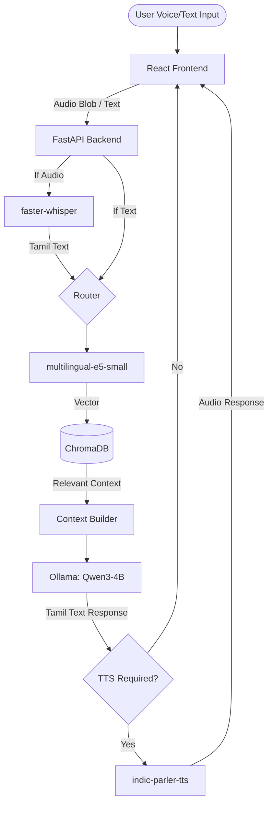

# Final Architecture

This document defines the locked final architecture for the Tamil Nadu Government Scheme Assistant MVP.

## Complete Technology Stack

| Component | Technology | Version | Justification |
| :--- | :--- | :--- | :--- |
| **Frontend** | React + Vite | React 18.x | Lightweight, fast compilation. |
| **Styling** | Tailwind CSS + shadcn/ui | Tailwind 3.x | Zero-config, beautiful accessible UI. |
| **Backend API** | Python + FastAPI | Python 3.10+ | Async support, easy ML integration. |
| **Vector DB** | ChromaDB | Latest | Local persistent storage, no cloud required. |
| **Relational DB**| SQLite with FTS5 | Standard Lib | Zero-config, handles structured scheme data. |
| **LLM Runner** | Ollama | Latest | Best local inference engine for quantized GGUF models. |

## Complete Model Selection (HuggingFace IDs)

| Role | Model HF ID / Name | Quantization | Size in RAM |
| :--- | :--- | :--- | :--- |
| **ASR** | `Systran/faster-whisper-large-v3-turbo` | INT8 | ~1.5 GB |
| **Embedding** | `intfloat/multilingual-e5-small` | FP32 | ~0.5 GB |
| **LLM** | `Qwen/Qwen2.5-3B-Instruct` (via Ollama `qwen:4b-instruct-q4_K_M`) | 4-bit GGUF | ~2.5 GB |
| **TTS** | `ai4bharat/indic-parler-tts` | FP32 | ~1.0 GB |
| **Total RAM** | | | **~5.5 GB** |

## Data Flow

## Deployment Configurations

### 1. BEST OVERALL (16GB RAM +)
*   **LLM:** Llama-3.1-8B-Instruct (via Ollama).
*   **ASR:** faster-whisper large-v3.
*   **Execution:** All models loaded in RAM simultaneously for lowest latency (<5s).

### 2. LOW HARDWARE (8GB RAM - MVP Target)
*   **LLM:** Qwen3-4B-Instruct or Sarvam-2B.
*   **Execution:** Strict sequential loading or relying heavily on swap space. `LOW_MEM_MODE=true` drops TTS if RAM pressure is high. Latency (~8-12s).

### 3. FULLY CLOUD / ZERO LOCAL COMPUTE (Optional Fallback)
*   If user hardware cannot run local models, API routes switch to using Groq (Llama3) for LLM and ASR, utilizing free API tiers. (Code exists as fallback only; primary goal is local).
